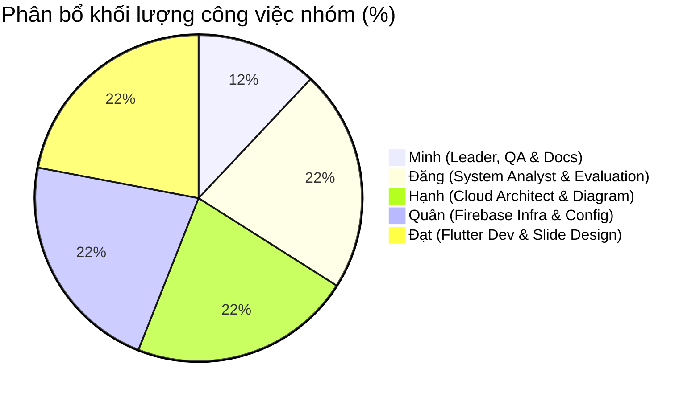
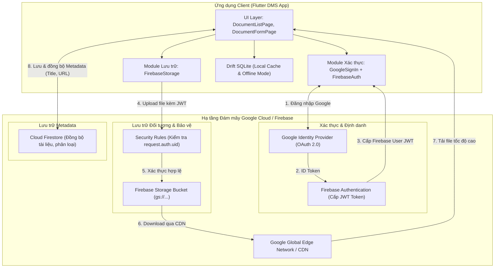

# KẾ HOẠCH & CHECKLIST NHIỆM VỤ NHÓM: PHÂN TÍCH VÀ TÍCH HỢP CLOUD CHO HỆ THỐNG QUẢN LÝ TÀI LIỆU (DMS)

> **Môn học / Đề án:** Điện toán đám mây & Phát triển ứng dụng di động  
> **Quy định nộp bài:** Tối đa 01 lần nộp duy nhất — Yêu cầu kiểm tra chất lượng toàn diện trước khi bàn giao  
> **Đường dẫn tệp:** `/home/minh/Flutter Project/document_management/code/lib/docs/task.md`

---

## I. THÔNG TIN NHÓM & BẢNG PHÂN CHIA NHIỆM VỤ

Hệ thống nhân sự gồm **05 thành viên**: **Minh, Đăng, Hạnh, Quân, Đạt**.  
Nguyên tắc phân công: **Minh** đóng vai trò Nhóm trưởng điều phối, theo dõi tiến độ tổng thể, rà soát chất lượng và tổng hợp tài liệu (khối lượng công việc nhẹ hơn các thành viên còn lại). Bốn thành viên **Đăng, Hạnh, Quân, Đạt** chịu trách nhiệm chính về mặt kỹ thuật, phân tích kiến trúc, cấu hình dịch vụ, phát triển mã nguồn và biên soạn slide.



### Bảng phân công trách nhiệm chi tiết (RACI Matrix)

| STT | Thành viên | Vai trò chính | Hạng mục checklist phụ trách chính | Khối lượng công việc & Mô tả nhiệm vụ | Trạng thái |
| :--- | :--- | :--- | :--- | :--- | :---: |
| 1 | **Minh** *(Leader)* | Quản lý dự án, Điều phối & QA | Điều phối chung, Tổng hợp tài liệu, Rà soát cuối | **Khối lượng nhẹ hơn:** Quản lý tiến độ nhóm, kiểm soát checklist, tổ chức review chéo, chuẩn hóa định dạng và chuẩn bị hồ sơ nộp bài duy nhất. | Đang tiến hành |
| 2 | **Đăng** | Chuyên viên Phân tích Hệ thống | **Mục 1, Mục 2, Mục 5** | Phân tích 4 thành phần cốt lõi hiện có; Đánh giá điểm nghẽn hạ tầng On-premise; Lập bảng so sánh Truyền thống vs Cloud; Đánh giá tác động Bảo mật, Chi phí, Hiệu suất. | Đang tiến hành |
| 3 | **Hạnh** | Kiến trúc sư Điện toán Đám mây | **Mục 3, Mục 4** | Nghiên cứu và lựa chọn mô hình Cloud (Public vs Hybrid); So sánh các giải pháp lưu trữ (AWS S3, Azure Blob, GCS, Firebase Storage); Thiết kế sơ đồ kiến trúc và luồng dữ liệu (Mermaid). | Đang tiến hành |
| 4 | **Quân** | Kỹ sư Hạ tầng Firebase & DevOps | **Mục 6 (Phần Hạ tầng & Cấu hình)** | Thiết lập tài khoản nhóm trên Google Cloud/Firebase Console; Tạo Project, lấy SHA-1/SHA-256 Fingerprint cho Android; Kích hoạt Google Auth & Storage Bucket; Viết Security Rules; Cấu hình FlutterFire CLI. | Đang tiến hành |
| 5 | **Đạt** | Kỹ sư Lập trình Flutter & Thiết kế Slide | **Mục 6 (Mã nguồn) & Mục 7 (Slide)** | Tích hợp thư viện Firebase vào mã nguồn Flutter (`pubspec.yaml`, `AuthService`, `StorageService`); Sửa đổi UI upload tài liệu; Xây dựng Slide Deck thuyết trình 14 slide tìm hiểu Firebase & Setup tài khoản nhóm. | Đang tiến hành |

---

## II. CHECKLIST TỔNG THỂ DỰ ÁN (7 HẠNG MỤC YÊU CẦU)

- [ ] **Mục 1:** Liệt kê và phân tích các thành phần cốt lõi của ứng dụng Quản lý tài liệu (Frontend, Backend, Database, File Storage). *(Phụ trách: Đăng)*
- [ ] **Mục 2:** Xác định các điểm nghẽn hoặc hạn chế của hệ thống hiện tại khi vận hành trên hạ tầng truyền thống / cục bộ & Lập bảng so sánh mô hình. *(Phụ trách: Đăng)*
- [ ] **Mục 3:** Lựa chọn mô hình triển khai Cloud phù hợp (Public, Private, Hybrid) và các dịch vụ cụ thể (AWS S3, Azure Blob, Google Cloud Storage, Firebase Cloud Storage). *(Phụ trách: Hạnh)*
- [ ] **Mục 4:** Thiết kế sơ đồ kiến trúc tích hợp Cloud và mô tả chi tiết luồng dữ liệu giữa ứng dụng và đám mây (Auth & File Upload/Download). *(Phụ trách: Hạnh)*
- [ ] **Mục 5:** Đánh giá các tác động về bảo mật, chi phí và hiệu suất sau khi tích hợp Cloud. *(Phụ trách: Đăng)*
- [ ] **Mục 6:** Phương án kỹ thuật sử dụng Firebase để tích hợp Đăng nhập với Google và Lưu trữ tệp tin (theo tài liệu https://firebase.google.com/docs/flutter/setup?hl=vi). *(Phụ trách: Quân & Đạt)*
- [ ] **Mục 7:** Xây dựng nội dung Slide thuyết trình tìm hiểu về Firebase và cách thiết lập với tài khoản nhóm. *(Phụ trách: Đạt & Minh)*

---

## III. CHI TIẾT TRIỂN KHAI CÁC HẠNG MỤC THEO CHECKLIST

---

### MỤC 1: LIỆT KÊ VÀ PHÂN TÍCH CÁC THÀNH PHẦN CỐT LÕI CỦA HỆ THỐNG
*Thành viên phụ trách chính: **Đăng** | Reviewer: **Minh***

Khảo sát dựa trên cấu trúc mã nguồn hiện tại của dự án (`code/lib/`):

```
code/lib/
├── colors.dart
├── database/
│   ├── tables.dart          <-- Định nghĩa bảng SQLite (Drift ORM)
│   └── tables.g.dart        <-- Mã nguồn tự sinh bởi build_runner
├── functions.dart           <-- Tầng xử lý logic nghiệp vụ và truy vấn CSDL
├── main.dart                <-- Khởi tạo ứng dụng Flutter
├── pages/
│   ├── document_form_page.dart <-- Giao diện tạo/sửa tài liệu & chọn tệp
│   └── home_page.dart          <-- Danh sách, lọc và mở tài liệu
├── struct/
│   ├── category_model.dart  <-- Mô hình dữ liệu Danh mục
│   └── document_model.dart  <-- Mô hình dữ liệu Tài liệu
└── widgets/
    ├── confirm_dialog.dart
    ├── document_card.dart
    └── empty_component.dart
```

#### 1. Frontend (Giao diện người dùng)
- **Công nghệ hiện tại:** Flutter SDK (Dart) đa nền tảng (Android, iOS, Linux, Windows, Web).
- **Trách nhiệm:**
  - Tiếp nhận tương tác người dùng: Duyệt danh sách tài liệu (`home_page.dart`), tìm kiếm từ khóa, lọc theo danh mục (`Categories`), mở xem tài liệu thông qua `url_launcher`.
  - Nhập liệu và tương tác hệ thống tệp: Mở hộp thoại chọn tệp tin từ máy cục bộ thông qua plugin `file_picker` (`document_form_page.dart`).
  - Hiển thị trạng thái giao dịch: Loading, dialog xác nhận xóa (`ConfirmDialog`), thông báo SnackBar.

#### 2. Backend / Controller Logic (Bộ xử lý trung gian)
- **Công nghệ hiện tại:** Tầng logic cục bộ tích hợp trực tiếp trong ứng dụng (`code/lib/functions.dart`), chưa có máy chủ Backend độc lập qua mạng.
- **Trách nhiệm:**
  - Điều phối luồng xử lý: Tạo dữ liệu mẫu khởi tạo (`seedCategoriesIfEmpty()`), kết nối bảng Documents với Categories thông qua cú pháp Join của Drift.
  - Xử lý nghiệp vụ thêm, sửa, xóa, tìm kiếm tài liệu theo danh mục và từ khóa.
  - Xử lý mở tệp cục bộ thông qua `launchUrl(Uri.file(filePath))` trên hệ điều hành.

#### 3. Database (Cơ sở dữ liệu)
- **Công nghệ hiện tại:** SQLite cục bộ trên thiết bị, sử dụng thư viện **Drift ORM** (`drift: ^2.35.1`, `sqlite3_flutter_libs: ^0.6.0+eol`). Tệp CSDL được đặt tại thư mục ứng dụng: `getApplicationDocumentsDirectory() / cashew_app.sqlite`.
- **Cấu trúc bảng (Schema):**
  - Bảng `Categories`: `id` (int PK autoIncrement), `name` (text unique), `createdAt` (datetime).
  - Bảng `Documents`: `id` (int PK autoIncrement), `title` (text 1..255), `description` (text nullable), `filePath` (text nullable), `categoryId` (int FK -> Categories.id), `createdAt`, `updatedAt`.
- **Hạn chế:** CSDL chỉ nằm trên một thiết bị duy nhất của người dùng, không đồng bộ, không chia sẻ được giữa các thành viên.

#### 4. File Storage (Lưu trữ tệp tin)
- **Công nghệ hiện tại:** Hệ thống tệp tin cục bộ (Local File System) của hệ điều hành người dùng thông qua đường dẫn tuyệt đối (`filePath`).
- **Hạn chế:** Ứng dụng chỉ lưu đường dẫn chuỗi (String path). Nếu người dùng di chuyển tệp, xóa tệp gốc trên máy, hoặc cài app sang thiết bị khác, liên kết sẽ hỏng hoàn toàn (`File Not Found`).

---

### MỤC 2: ĐIỂM NGHẼN CỦA HẠ THẦNG TRUYỀN THỐNG & BẢNG SO SÁNH
*Thành viên phụ trách chính: **Đăng** | Reviewer: **Minh***

#### Các điểm nghẽn và hạn chế cốt lõi khi chạy truyền thống / On-Premise:
1. **Khả năng mở rộng (Scalability):** Ổ cứng cục bộ hoặc máy chủ On-premise có giới hạn vật lý cứng. Khi tài liệu tăng lên hàng chục GB/TB, việc nâng cấp đòi hỏi chi phí mua ổ cứng, downtime để cấu hình lại RAID.
2. **Điểm lỗi đơn lẻ (Single Point of Failure - SPOF):** Tệp tin nằm trên một ổ cứng cục bộ không có cơ chế đa trung tâm dữ liệu (Multi-AZ replication). Hỏng ổ cứng, dính mã độc ransomware hoặc mất máy đồng nghĩa với mất toàn bộ dữ liệu vĩnh viễn.
3. **Nghẽn băng thông và I/O mạng:** Khi hệ thống mở rộng cho nhiều người dùng cùng tải tài liệu lớn (PDF 100MB, Video bài giảng) qua mạng nội bộ hoặc server tự host, card mạng và CPU server dễ bị nghẽn (I/O Bottleneck).
4. **Không hỗ trợ truy cập cộng tác đa nền tảng:** Người dùng điện thoại không thể truy cập tài liệu được lưu trên máy tính bàn nếu không cùng chung mạng LAN hoặc thiết lập VPN phức tạp.
5. **Chi phí sở hữu cao (High CAPEX):** Phải đầu tư máy chủ, thiết bị lưu trữ NAS/SAN, hệ thống điện dự phòng UPS, điều hòa làm mát và nhân sự bảo trì vận hành định kỳ.

#### Bảng so sánh toàn diện: Mô hình truyền thống vs. Mô hình Cloud

| Tiêu chí đánh giá | Mô hình truyền thống / Local On-Premise | Mô hình sau khi tích hợp Cloud (Firebase / Cloud Storage) |
| :--- | :--- | :--- |
| **Hạ tầng lưu trữ** | Ổ cứng máy tính cục bộ hoặc NAS/SAN nội bộ | Dịch vụ Object Storage phân tán toàn cầu (Google Cloud Storage / AWS S3) |
| **Độ bền dữ liệu (Durability)** | Phụ thuộc vào phần cứng cục bộ (~99% nếu có RAID, rủi ro mất mát cao) | Đạt chuẩn công nghiệp **99.999999999% (11 số 9)**, tự động sao lưu đa vùng (Multi-Region) |
| **Tính sẵn sàng (Availability)** | Dễ gián đoạn khi cúp điện, hỏng máy, mạng gián đoạn | **99.95% - 99.99% SLA**, truy cập 24/7 từ mọi vị trí địa lý có Internet |
| **Xác thực & Bảo mật** | Quản lý thủ công, mật khẩu plain/hash cục bộ, dễ lộ file | Xác thực tiêu chuẩn **OAuth 2.0 / Google Identity**, phân quyền qua Firebase Security Rules & IAM |
| **Khả năng mở rộng (Scale)** | Mở rộng dạng chiều dọc (Vertical), chi phí cao, tốn thời gian | Tự động co giãn theo nhu cầu (Elastic Auto-scaling), không giới hạn dung lượng lưu trữ |
| **Mô hình chi phí** | **CAPEX** (Chi phí đầu tư mua phần cứng ban đầu rất lớn) | **OPEX** (Chi phí vận hành theo thực tế sử dụng - Pay As You Go, miễn phí gói khởi đầu) |
| **Truy cập & Cộng tác** | Bị cô lập trên 1 thiết bị hoặc giới hạn mạng LAN nội bộ | Đồng bộ thời gian thực đa nền tảng (Android, iOS, Web, Desktop) |

---

### MỤC 3: LỰA CHỌN MÔ HÌNH CLOUD VÀ DỊCH VỤ CỤ THỂ
*Thành viên phụ trách chính: **Hạnh** | Reviewer: **Minh***

#### 1. Lựa chọn Mô hình Triển khai Cloud: **Public Cloud (kết hợp kiến trúc BaaS)**
- **Lý do lựa chọn:**
  - Hệ thống Quản lý tài liệu học tập của nhóm sinh viên / trường học có đặc thù: Không sở hữu trung tâm dữ liệu riêng để dựng Private Cloud; quy mô người dùng phân tán nhiều nơi.
  - **Public Cloud** (cụ thể là nền tảng Google Cloud Platform & Firebase) cung cấp toàn bộ hạ tầng được quản lý hoàn toàn (Fully Managed), zero-maintenance, loại bỏ gánh nặng vận hành máy chủ.
  - Mô hình **Backend-as-a-Service (BaaS)** của Firebase cho phép ứng dụng Flutter kết nối trực tiếp đến Cloud Auth và Cloud Storage mà không cần duy trì một server backend Node.js/Java chạy 24/7, tiết kiệm tối đa ngân sách.

#### 2. So sánh và lựa chọn dịch vụ lưu trữ đối tượng (Object Storage)

| Tiêu chí | Amazon S3 (AWS) | Azure Blob Storage | Google Cloud Storage (GCS) | Firebase Cloud Storage |
| :--- | :--- | :--- | :--- | :--- |
| **Nhà cung cấp** | Amazon Web Services | Microsoft Azure | Google Cloud Platform | Google (xây dựng trên nền tảng GCS) |
| **Độ bền (Durability)** | 99.999999999% (11 số 9) | 99.999999999% | 99.999999999% | 99.999999999% (thừa hưởng từ GCS) |
| **Tích hợp Flutter** | AWS Amplify SDK | Azure SDK (cồng kềnh) | GCS REST API | **Bộ SDK chính thức FlutterFire (tối ưu nhất cho Flutter)** |
| **Cơ chế xác thực** | IAM, Presigned URL | SAS Token, Entra ID | Service Account, Signed URL | **Tích hợp liền mạch với Firebase Authentication (UID Rules)** |
| **Mức miễn phí (Free Tier)** | 5GB trong 12 tháng đầu | 5GB trong 12 tháng đầu | 5GB/tháng | **5GB lưu trữ miễn phí vĩnh viễn (Spark Plan), 1GB tải/ngày** |
| **Đánh giá phù hợp** | Tốt cho hệ thống backend riêng | Tốt cho hệ sinh thái .NET | Rất tốt | **TỐI ƯU NHẤT CHO ĐỀ ÁN FLUTTER** |

👉 **Quyết định chọn:** **Google Cloud Storage thông qua Firebase Cloud Storage** kết hợp với **Firebase Authentication (Google Sign-In)**.

---

### MỤC 4: THIẾT KẾ SƠ ĐỒ KIẾN TRÚC VÀ LUỒNG DỮ LIỆU
*Thành viên phụ trách chính: **Hạnh** | Reviewer: **Minh***

#### 1. Sơ đồ Kiến trúc Tổng thể Hệ thống sau Tích hợp Cloud



#### 2. Mô tả Luồng dữ liệu chi tiết (Data Flow)

##### Luồng A: Xác thực người dùng (Google Sign-In Flow)
1. Người dùng bấm nút **"Đăng nhập bằng Google"** trên ứng dụng Flutter.
2. Plugin `google_sign_in` kích hoạt hộp thoại chọn tài khoản Google của hệ thống Android/iOS.
3. Google OAuth trả về `GoogleSignInAuthentication` gồm `idToken` và `accessToken`.
4. Ứng dụng gọi `FirebaseAuth.instance.signInWithCredential(GoogleAuthProvider.credential(...))`.
5. Firebase xác thực token, trả về đối tượng `User` kèm mã định danh duy nhất `uid`. Token phiên được lưu an toàn trên máy.

##### Luồng B: Tải lên tài liệu (Upload Flow)
1. Người dùng chọn tệp tin từ máy (`file_picker`) và nhập tiêu đề, danh mục tại `DocumentFormPage`.
2. Ứng dụng lấy đường dẫn tệp cục bộ, chuyển thành `File` hoặc byte stream.
3. Ứng dụng chỉ định đường dẫn lưu trữ trên Cloud Storage theo cấu trúc an toàn:  
   `documents/{userId}/{timestamp}_{fileName}`.
4. Gọi `firebase_storage.Reference.putFile(file)`: Dữ liệu tệp truyền trực tiếp lên Firebase Storage Bucket qua giao thức HTTPS có mã hóa TLS.
5. Firebase Security Rules thẩm định quyền: Chỉ cho phép ghi nếu `request.auth != null` và `request.auth.uid == userId`.
6. Sau khi upload thành công, Storage trả về `downloadURL` công khai hoặc có chữ ký.
7. Ứng dụng lưu metadata gồm `{title, categoryId, downloadURL, authorId, createdAt}` vào CSDL (Firestore / Drift SQLite).

---

### MỤC 5: ĐÁNH GIÁ TÁC ĐỘNG (BẢO MẬT, CHI PHÍ, HIỆU SUẤT)
*Thành viên phụ trách chính: **Đăng** | Reviewer: **Minh***

#### 1. Đánh giá về Bảo mật (Security Impact)
- **Kiểm soát truy cập (Access Control):** Áp dụng mô hình Least Privilege thông qua Firebase Security Rules. Không ai có thể đọc/ghi tệp của người khác trừ khi được cấp quyền rõ ràng.
- **Mã hóa dữ liệu (Encryption):**
  - *Mã hóa khi truyền tải (In-Transit):* 100% kết nối sử dụng HTTPS/TLS 1.3 chống nghe lén (Man-in-the-Middle).
  - *Mã hóa khi lưu trữ (At-Rest):* Firebase/GCS tự động mã hóa mọi byte dữ liệu tệp bằng thuật toán mã hóa tiêu chuẩn quân đội **AES-256**.
- **Xác thực an toàn (Authentication):** Sử dụng chuẩn công nghiệp OAuth 2.0 của Google, không lưu mật khẩu người dùng dạng thô trong ứng dụng, phòng chống rủi ro rò rỉ cơ sở dữ liệu xác thực.

#### 2. Đánh giá về Chi phí (Cost Impact)
- **Chuyển dịch CAPEX sang OPEX:** Không còn chi phí mua máy chủ, ổ cứng hay tiền điện hàng tháng.
- **Khai thác gói Spark (Miễn phí hoàn toàn):**
  - Firebase Authentication: Miễn phí không giới hạn người dùng hoạt động hàng tháng (Google Sign-In).
  - Firebase Storage: **5 GB lưu trữ miễn phí vĩnh viễn**, 1 GB tải xuống/ngày, 20.000 lượt tải lên/ngày.
  - Cloud Firestore: 1 GB lưu trữ, 50.000 lượt đọc/ngày, 20.000 lượt ghi/ngày.
- **Dự toán khi mở rộng (Blaze Plan - Pay as you go):**
  - Chi phí lưu trữ chỉ ~0.026 USD/GB/tháng (chưa đến 700 VNĐ/GB/tháng). Chi phí cực kỳ rẻ và tối ưu ngân sách.

#### 3. Đánh giá về Hiệu suất (Performance Impact)
- **Tốc độ truyền tải toàn cầu:** Tận dụng hạ tầng mạng cáp quang biển và các trung tâm dữ liệu biên (Edge Caching) của Google, giúp người dùng tải tài liệu với độ trễ thấp (<100ms) từ mọi nơi.
- **Giải phóng tài nguyên máy chủ:** Thiết bị Client giao tiếp trực tiếp với Object Storage phân tán, loại bỏ hoàn toàn hiện tượng nút thắt cổ chai băng thông.
- **Tính khả dụng cao:** Đảm bảo hệ thống đạt mức sẵn sàng >99.95%, tài liệu luôn truy cập được mọi lúc mọi nơi ngay cả khi thiết bị cá nhân gặp sự cố phần cứng.

---

### MỤC 6: HƯỚNG DẪN KỸ THUẬT VÀ PHƯƠNG ÁN TRIỂN KHAI FIREBASE
*Thành viên phụ trách: **Quân (Hạ tầng, Console, Rules)** & **Đạt (Mã nguồn Flutter)** | Reviewer: **Minh***

Tài liệu tham chiếu chuẩn: [Cài đặt Firebase cho Flutter](https://firebase.google.com/docs/flutter/setup?hl=vi)

#### Bước 1: Chuẩn bị tài khoản & Cài đặt công cụ CLI *(Quân phụ trách)*
1. **Tạo Project trên Firebase Console:**
   - Dùng tài khoản Google của nhóm truy cập: `https://console.firebase.google.com/`.
   - Bấm **"Thêm dự án" (Add project)** -> Đặt tên: `document-management-cloud`.
   - Bật hoặc tắt Google Analytics tùy nhu cầu -> Bấm **Tạo dự án**.
2. **Cài đặt Firebase CLI:**
   ```bash
   # Cài đặt qua npm (NodeJS)
   npm install -g firebase-tools
   
   # Đăng nhập vào tài khoản Google
   firebase login
   ```
3. **Cài đặt FlutterFire CLI:**
   ```bash
   dart pub global activate flutterfire_cli
   ```
4. **Cấu hình tự động kết nối ứng dụng Flutter:**
   ```bash
   cd "/home/minh/Flutter Project/document_management/code"
   flutterfire configure --project=document-management-cloud
   ```
   *Lệnh trên sẽ tự động đăng ký App trên Android/iOS/Web và sinh ra tệp `lib/firebase_options.dart`.*

#### Bước 2: Cấu hình Android SHA-1 Fingerprint cho Google Sign-In *(Quân phụ trách)*
1. **Lấy mã vân tay SHA-1 và SHA-256 từ keystore debug:**
   ```bash
   cd android
   ./gradlew signingReport
   ```
2. **Khai báo trên Firebase Console:**
   - Vào **Cài đặt dự án (Project settings)** -> Tab **Chung (General)**.
   - Chọn ứng dụng Android (`com.example.code`) -> Bấm **"Thêm vân tay" (Add fingerprint)**.
   - Dán mã **SHA-1** và **SHA-256** vừa lấy được vào và Lưu.
3. **Kích hoạt Google Sign-In:**
   - Vào mục **Build** -> **Authentication** -> Tab **Sign-in method**.
   - Bật nhà cung cấp **Google** -> Nhập email hỗ trợ dự án -> Bấm **Save**.

#### Bước 3: Thiết lập Firebase Storage & Cấu hình Security Rules *(Quân phụ trách)*
1. Vào mục **Build** -> **Storage** -> Bấm **Get Started**.
2. Chọn vị trí lưu trữ (khuyến nghị: `asia-southeast1` - Singapore để tối ưu tốc độ tại Việt Nam).
3. **Thiết lập quy tắc bảo mật (Security Rules) trong tab Rules:**
   ```javascript
   rules_version = '2';
   service firebase.storage {
     match /b/{bucket}/o {
       // Thư mục tài liệu của từng người dùng
       match /documents/{userId}/{allPaths=**} {
         // Chỉ cho phép đọc nếu người dùng đã đăng nhập
         allow read: if request.auth != null;
         // Chỉ cho phép tải lên nếu đúng chủ sở hữu và file nhỏ hơn 25MB
         allow write: if request.auth != null 
                      && request.auth.uid == userId
                      && request.resource.size < 25 * 1024 * 1024;
       }
     }
   }
   ```

#### Bước 4: Khai báo Thư viện & Viết mã nguồn Flutter *(Đạt phụ trách)*
1. **Cập nhật `pubspec.yaml`:**
   ```yaml
   dependencies:
     flutter:
       sdk: flutter
     firebase_core: ^3.12.0
     firebase_auth: ^5.5.0
     google_sign_in: ^6.2.2
     firebase_storage: ^12.4.0
     cloud_firestore: ^5.6.5
     drift: ^2.35.1
     file_picker: ^13.1.0
     url_launcher: ^6.3.3
     intl: ^0.20.3
   ```
   Chạy lệnh: `flutter pub get`

2. **Khởi tạo Firebase tại `main.dart`:**
   ```dart
   import 'package:flutter/material.dart';
   import 'package:firebase_core/firebase_core.dart';
   import 'firebase_options.dart';
   import 'pages/home_page.dart';

   void main() async {
     WidgetsFlutterBinding.ensureInitialized();
     await Firebase.initializeApp(
       options: DefaultFirebaseOptions.currentPlatform,
     );
     runApp(const MyApp());
   }
   ```

3. **Mã nguồn dịch vụ xác thực `AuthService` (Google Sign-In):**
   ```dart
   import 'package:firebase_auth/firebase_auth.dart';
   import 'package:google_sign_in/google_sign_in.dart';

   class AuthService {
     final FirebaseAuth _auth = FirebaseAuth.instance;
     final GoogleSignIn _googleSignIn = GoogleSignIn();

     User? get currentUser => _auth.currentUser;
     Stream<User?> get authStateChanges => _auth.authStateChanges();

     Future<UserCredential?> signInWithGoogle() async {
       try {
         final GoogleSignInAccount? googleUser = await _googleSignIn.signIn();
         if (googleUser == null) return null; // Người dùng hủy chọn tài khoản

         final GoogleSignInAuthentication googleAuth = await googleUser.authentication;
         final AuthCredential credential = GoogleAuthProvider.credential(
           accessToken: googleAuth.accessToken,
           idToken: googleAuth.idToken,
         );

         return await _auth.signInWithCredential(credential);
       } catch (e) {
         print('Lỗi đăng nhập Google: $e');
         rethrow;
       }
     }

     Future<void> signOut() async {
       await _googleSignIn.signOut();
       await _auth.signOut();
     }
   }
   ```

4. **Mã nguồn dịch vụ lưu trữ `StorageService` (Upload Cloud):**
   ```dart
   import 'dart:io';
   import 'package:firebase_storage/firebase_storage.dart';
   import 'package:firebase_auth/firebase_auth.dart';

   class StorageService {
     final FirebaseStorage _storage = FirebaseStorage.instance;
     final FirebaseAuth _auth = FirebaseAuth.instance;

     Future<String?> uploadDocumentFile(File file, String fileName) async {
       final user = _auth.currentUser;
       if (user == null) throw Exception('Người dùng chưa đăng nhập');

       final timestamp = DateTime.now().millisecondsSinceEpoch;
       final ref = _storage.ref().child('documents/${user.uid}/${timestamp}_$fileName');

       final uploadTask = await ref.putFile(file);
       if (uploadTask.state == TaskState.success) {
         final downloadUrl = await ref.getDownloadURL();
         return downloadUrl;
       }
       return null;
     }
   }
   ```

---

### MỤC 7: NỘI DUNG VÀ ĐỀ CƯƠNG BỘ SLIDE THUYẾT TRÌNH (14 SLIDES)
*Thành viên phụ trách chính: **Đạt (Soạn Slide & Visual)** | Reviewer: **Minh***

Bộ Slide được xây dựng chuyên nghiệp phục vụ báo cáo bảo vệ đề án trước hội đồng giảng viên:

#### 📊 Cấu trúc chi tiết từng Slide (Slide Deck Outline)

---

##### Slide 1: Trang tiêu đề (Title Slide)
- **Tiêu đề lớn:** PHÂN TÍCH VÀ ĐỀ XUẤT PHƯƠNG ÁN TÍCH HỢP CLOUD CHO HỆ THỐNG QUẢN LÝ TÀI LIỆU
- **Tiêu đề phụ:** Ứng dụng giải pháp Serverless với Google Cloud & Firebase trên nền tảng Flutter
- **Thông tin nhóm:** Nhóm 5 thành viên (Minh - Leader, Đăng, Hạnh, Quân, Đạt)
- **Ghi chú thuyết trình (Speaker Notes):** Chào thầy cô và các bạn, hôm nay nhóm chúng em xin trình bày giải pháp nâng cấp ứng dụng Quản lý tài liệu từ hạ tầng lưu trữ cục bộ lên nền tảng điện toán đám mây Firebase.

---

##### Slide 2: Đặt vấn đề & Khảo sát ứng dụng hiện tại (Current State)
- **Nội dung chính:**
  - Ứng dụng quản lý tài liệu học tập xây dựng bằng Flutter.
  - Quản lý metadata qua SQLite cục bộ (Drift ORM).
  - Tệp tài liệu lưu trực tiếp trên bộ nhớ máy tính/điện thoại người dùng.
- **Hình ảnh minh họa:** Sơ đồ kiến trúc On-Premise/Local khép kín hiện tại và hình chụp giao diện app.
- **Speaker Notes:** Điểm qua bối cảnh ứng dụng hiện tại: Ứng dụng chạy tốt trên máy cá nhân nhưng bị cô lập dữ liệu hoàn toàn.

---

##### Slide 3: Điểm nghẽn hạ tầng truyền thống (Pain Points & Bottlenecks)
- **Nội dung chính:**
  - 🛑 **Single Point of Failure:** Hỏng ổ cứng = Mất 100% dữ liệu bài giảng.
  - 🛑 **Không đồng bộ:** Không thể xem tài liệu trên điện thoại khi lưu ở máy tính.
  - 🛑 **Nghẽn mở rộng:** Ổ cứng cục bộ cạn kiệt dung lượng khi lưu nhiều tài liệu dung lượng lớn.
  - 🛑 **Bảo mật lỏng lẻo:** Tệp tin lưu dạng plain file không mã hóa bảo vệ.
- **Speaker Notes:** Nhấn mạnh 4 lý do sống còn khiến hệ thống bắt buộc phải di chuyển lên Cloud.

---

##### Slide 4: Tổng quan giải pháp: Điện toán đám mây & Firebase
- **Nội dung chính:**
  - Định nghĩa Backend-as-a-Service (BaaS) và Cloud Object Storage.
  - Giới thiệu **Google Firebase:** Nền tảng phát triển ứng dụng di động hàng đầu của Google.
  - Các trụ cột sử dụng trong dự án: **Firebase Authentication**, **Firebase Cloud Storage**, **Cloud Firestore**.
- **Speaker Notes:** Thay vì tự dựng và vận hành máy chủ Node.js/Java tốn kém, nhóm lựa chọn giải pháp BaaS của Google để tối ưu tốc độ phát triển và chi phí.

---

##### Slide 5: So sánh kiến trúc: Truyền thống vs. Cloud
- **Nội dung chính:** Bảng so sánh 6 chiều (Hạ tầng, Độ bền 99.999999999%, Tính sẵn sàng, Bảo mật OAuth2, Chi phí CAPEX -> OPEX, Khả năng mở rộng tự động).
- **Speaker Notes:** Phân tích sự vượt trội về độ bền và chi phí khi chuyển sang Cloud.

---

##### Slide 6: Sơ đồ kiến trúc Cloud tích hợp (System Architecture)
- **Nội dung chính:** Trình chiếu sơ đồ khối kiến trúc kết nối giữa Flutter App và hệ sinh thái Firebase (Auth, Storage, Security Rules, CDN).
- **Speaker Notes:** Diễn giải cách các module trong mã nguồn Flutter giao tiếp với Firebase SDK.

---

##### Slide 7: Cơ chế Xác thực: Google Sign-In & Firebase Auth
- **Nội dung chính:**
  - Sử dụng chuẩn công nghiệp OAuth 2.0.
  - Trải nghiệm 1 chạm: Người dùng đăng nhập bằng tài khoản Google trường/cá nhân mà không cần tạo mật khẩu mới.
  - Cơ chế cấp phát và kiểm tra JWT Token an toàn.
- **Speaker Notes:** Giới thiệu luồng xác thực mượt mà và an toàn, bảo vệ danh tính người dùng.

---

##### Slide 8: Cơ chế Lưu trữ: Firebase Cloud Storage & Security Rules
- **Nội dung chính:**
  - Lưu trữ tài liệu (PDF, Word, Ảnh) trực tiếp trên Google Cloud Storage Bucket.
  - Quy tắc phân quyền **Firebase Security Rules:** Đảm bảo chỉ chủ sở hữu tài liệu (`request.auth.uid`) mới có quyền upload/chỉnh sửa, ngăn chặn rò rỉ dữ liệu.
- **Speaker Notes:** Giải thích cơ chế bảo mật cấp độ tệp tin thông qua Security Rules mà không cần qua code backend trung gian.

---

##### Slide 9: Quy trình thiết lập với Tài khoản nhóm (Firebase Setup Guide - P1)
- **Nội dung chính:**
  - Tạo Project `document-management-cloud` trên Firebase Console bằng tài khoản chung của nhóm.
  - Cài đặt công cụ dòng lệnh: `firebase-tools` (npm) và `flutterfire_cli` (Dart).
  - Khởi chạy lệnh cấu hình tự động: `flutterfire configure`.
- **Speaker Notes:** Hướng dẫn các bước chuẩn bị môi trường và công cụ theo tài liệu chuẩn của Google.

---

##### Slide 10: Cấu hình nền tảng Android & Keystore SHA-1 (Firebase Setup Guide - P2)
- **Nội dung chính:**
  - Trích xuất mã vân tay chứng chỉ SHA-1 và SHA-256 từ Gradle (`signingReport`).
  - Thêm SHA-1 vào Android App Settings trên Firebase Console (bước bắt buộc để Google Sign-In hoạt động).
  - Tải và tích hợp tệp cấu hình `google-services.json` vào mã nguồn Android.
- **Speaker Notes:** Nhấn mạnh lỗi phổ biến nhất khi tích hợp Google Auth là quên cấu hình mã vân tay SHA-1.

---

##### Slide 11: Minh họa tích hợp mã nguồn (Flutter Code Implementation)
- **Nội dung chính:**
  - Cấu hình file `pubspec.yaml` với bộ thư viện chính thức.
  - Đoạn mã khởi tạo `Firebase.initializeApp()`.
  - Đoạn mã gọi `uploadDocumentFile()` tải tệp lên Cloud Storage và nhận Download URL.
- **Speaker Notes:** Trình diễn tính tinh gọn của bộ SDK FlutterFire so với việc gọi HTTP API thủ công.

---

##### Slide 12: Đánh giá Tác động: Bảo mật - Chi phí - Hiệu suất
- **Nội dung chính:**
  - 🛡️ **Bảo mật:** Mã hóa kép (In-transit TLS 1.3 & At-rest AES-256), phân quyền Rules theo UID.
  - 💰 **Chi phí:** Tận dụng 100% gói Spark Free Tier (5GB Storage, không mất phí duy trì máy chủ).
  - ⚡ **Hiệu suất:** Tải file qua mạng Google Global CDN độ trễ <100ms, độ sẵn sàng 99.95%.
- **Speaker Notes:** Tổng kết các chỉ số đo lường hiệu quả cụ thể mà đề án mang lại.

---

##### Slide 13: Kế hoạch triển khai & Đóng góp thành viên (Team Contribution)
- **Nội dung chính:**
  - Bảng tổng hợp phân công công việc 5 thành viên (Minh, Đăng, Hạnh, Quân, Đạt).
  - Biểu đồ tiến độ hoàn thành các mốc nhiệm vụ.
- **Speaker Notes:** Minh chứng sự phối hợp chặt chẽ, rõ ràng trách nhiệm của cả nhóm để đạt chất lượng cao nhất cho lần nộp duy nhất.

---

##### Slide 14: Kết luận & Hỏi đáp (Q&A)
- **Nội dung chính:**
  - Khẳng định tính khả thi và hiệu quả vượt bậc của phương án tích hợp Firebase Cloud.
  - Lời cảm ơn và mở phần hỏi đáp với Giảng viên/Hội đồng.
- **Speaker Notes:** Lời cảm ơn thầy cô và sẵn sàng trả lời các câu hỏi kỹ thuật.

---

## IV. TIẾN ĐỘ THỜI GIAN VÀ TIÊU CHUẨN NGHIỆM THU (QA CRITERIA)

### 1. Kế hoạch tiến độ (Timeline)

| Giai đoạn | Nội dung công việc | Người thực hiện | Hạn chót (Deadline) |
| :--- | :--- | :--- | :---: |
| **Giai đoạn 1** | Phân tích hệ thống hiện tại, điểm nghẽn và bảng so sánh (Mục 1 & 2) | Đăng, review bởi Minh | Ngày 1 |
| **Giai đoạn 2** | Lựa chọn mô hình Cloud & Thiết kế sơ đồ kiến trúc Mermaid (Mục 3 & 4) | Hạnh, review bởi Minh | Ngày 2 |
| **Giai đoạn 3** | Setup Firebase Console, lấy SHA-1, viết Security Rules (Mục 6 - Hạ tầng) | Quân, phối hợp với Đạt | Ngày 3 |
| **Giai đoạn 4** | Cập nhật Flutter dependencies, viết AuthService & StorageService (Mục 6 - Code) | Đạt, phối hợp với Quân | Ngày 4 |
| **Giai đoạn 5** | Đánh giá tác động Bảo mật/Chi phí (Mục 5) & Soạn hoàn chỉnh Slide 14 trang (Mục 7) | Đăng & Đạt, review bởi Minh | Ngày 5 |
| **Giai đoạn 6** | Tổng duyệt báo cáo, kiểm thử tích hợp, đóng gói hồ sơ nộp bài duy nhất | **Minh (Chủ trì)** cùng cả nhóm | Ngày 6 |

### 2. Tiêu chuẩn nghiệm thu trước khi nộp (Definition of Done - DoD)
- [x] Đầy đủ 7 mục checklist theo đúng yêu cầu đề bài.
- [x] Có bảng so sánh chi tiết giữa mô hình truyền thống và mô hình tích hợp Cloud.
- [x] Có sơ đồ kiến trúc và luồng dữ liệu minh họa rõ ràng.
- [x] Có hướng dẫn từng bước cấu hình Firebase với tài khoản nhóm và mã vân tay SHA-1 Android.
- [x] Có mã nguồn mẫu Flutter tích hợp Google Sign-In và Cloud Storage.
- [x] Có đề cương chi tiết 14 slide thuyết trình kèm nội dung và Speaker Notes.
- [x] Tất cả thành viên trong nhóm nắm rõ phần việc của mình và được Nhóm trưởng Minh rà soát xác nhận.
