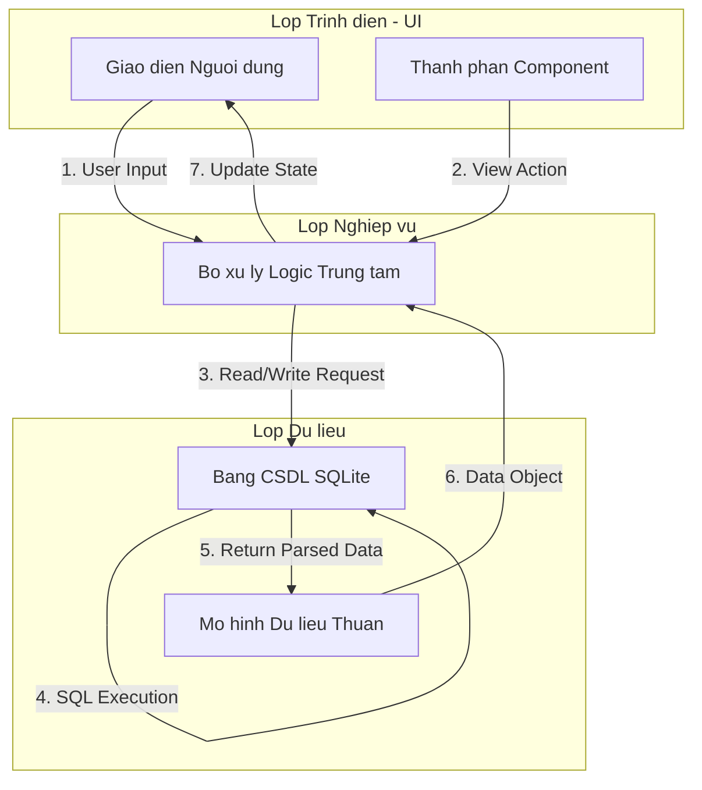

# BÁO CÁO: PHÂN TÍCH YÊU CẦU VÀ GIẢI TRÌNH KIẾN TRÚC CASHEW
*Dự án: Ứng dụng Quản lý Tài liệu Học tập*

---

## 1. Phân tích yêu cầu chức năng và Thiết kế sơ đồ luồng dữ liệu

### 1.1 Yêu cầu chức năng cốt lõi
Ứng dụng quản lý tài liệu học tập đóng vai trò như một kho lưu trữ cục bộ giúp sinh viên sắp xếp bài giảng, bài tập và tài liệu tham khảo. Các tính năng cốt lõi bao gồm:
- **Thêm tài liệu:** Cho phép người dùng nhập Tên tài liệu (bắt buộc), Phân loại danh mục (Bài giảng/Bài tập/Tham khảo), Mô tả chi tiết và đính kèm đường dẫn File (tùy chọn).
- **Sửa tài liệu:** Cho phép cập nhật lại thông tin của tài liệu đã tồn tại trong hệ thống (thay tên, đổi file, đổi danh mục).
- **Xóa tài liệu:** Loại bỏ vĩnh viễn tài liệu khỏi cơ sở dữ liệu để giải phóng bộ nhớ.
- **Tìm kiếm & Liệt kê:** Hiển thị danh sách toàn bộ tài liệu, cung cấp thanh tìm kiếm (theo tên/mô tả) và bộ lọc theo từng danh mục cụ thể.

### 1.2 Thiết kế sơ đồ luồng dữ liệu (Data Flow Diagram)
Để đảm bảo tính mô-đun hóa và khả năng mở rộng, luồng dữ liệu của ứng dụng được thiết kế tuân thủ nguyên lý tách lớp nghiêm ngặt:
- **Lớp Trình diễn (UI):** Nhận tương tác (click, type) nhưng **tuyệt đối không** chứa câu lệnh SQL.
- **Lớp Nghiệp vụ (Logic):** Tiếp nhận luồng sự kiện từ UI, xử lý tính toán và gọi Database.
- **Lớp Dữ liệu (Database/Struct):** Truy vấn SQLite và trả về các Object (Struct) thuần túy.

---

## 2. Báo cáo giải trình: Cách áp dụng Kiến trúc Cashew vào dự án

1. **Thư mục `lib/database/` (Tầng Persistence):** Nơi duy nhất chứa các import của thư viện `drift` và `sqlite3`. Toàn bộ Schema (bảng Categories và Documents) được định nghĩa tại đây. Điều này tách biệt hoàn toàn rủi ro thay đổi công nghệ cơ sở dữ liệu khỏi mã nguồn giao diện.
2. **Thư mục `lib/struct/` (Tầng Transfer Object):** Để UI không bị phụ thuộc vào các Class sinh tự động của Drift, chúng tôi tạo ra các Data Model thuần túy (`document_model.dart`). Đây là cầu nối an toàn, đảm bảo nếu Database sập, UI vẫn có thể render dummy data.
3. **File `lib/functions.dart` (Tầng Service/Logic):** Đóng vai trò là "Tổng đài viên". Nó chứa các hàm `addDocument`, `getDocuments`... Không một File giao diện nào được phép gọi thẳng SQLite, mọi thứ phải đi qua cổng `functions.dart`.
4. **Thư mục `lib/widgets/` (Tầng Component):** Nhằm tối đa hóa tái sử dụng, các thành phần như thẻ tài liệu (`document_card.dart`), hộp thoại xác nhận xóa (`confirm_dialog.dart`) hay giao diện rỗng (`empty_component.dart`) được tách rời. Các màn hình chính (Pages) chỉ việc lắp ghép chúng lại.
5. **Thư mục `lib/pages/` (Tầng View):** Hoàn toàn "mỏng" (thin layer). Nhiệm vụ của nó chỉ là lắng nghe dữ liệu từ `functions.dart` và gọi các thành phần từ `widgets/` ra để hiển thị.
