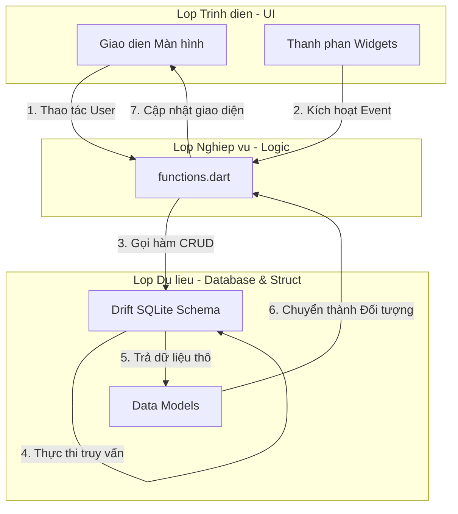

# BÁO CÁO BÀI TẬP: ỨNG DỤNG QUẢN LÝ TÀI LIỆU HỌC TẬP
**Kiến trúc áp dụng:** Cashew Architecture

---

## 1. Phân tích yêu cầu chức năng và thiết kế sơ đồ luồng dữ liệu

### 1.1 Phân tích yêu cầu chức năng
Ứng dụng đóng vai trò là một kho lưu trữ cục bộ, giúp sinh viên quản lý hiệu quả các tài nguyên học tập cá nhân. Các chức năng cốt lõi được định nghĩa:
- **Thêm tài liệu:** Người dùng nhập Tiêu đề, Chọn Danh mục (Bài giảng, Bài tập, Tham khảo), Ghi chú và đính kèm đường dẫn File (File là tuỳ chọn/không bắt buộc).
- **Sửa tài liệu:** Cập nhật lại các thông tin của tài liệu đã có.
- **Xóa tài liệu:** Xóa bỏ vĩnh viễn tài liệu khỏi cơ sở dữ liệu hệ thống.
- **Tìm kiếm & Liệt kê:** Hiển thị danh sách tất cả tài liệu hiện có, cho phép gõ từ khóa tìm kiếm theo tên và lọc theo từng danh mục.

### 1.2 Thiết kế sơ đồ luồng dữ liệu (Data Flow)
Theo nguyên lý Cashew, UI không được phép truy vấn Database. Mọi luồng dữ liệu phải đi qua lớp Logic.



---

## 2. Thiết lập cấu trúc thư mục và phân lớp hệ thống theo chuẩn Cashew

Toàn bộ dự án được ánh xạ chặt chẽ theo cấu trúc 5 tầng của kiến trúc Cashew gốc (`group3-cashew`). Cấu trúc thư mục `lib/` hiện tại:

```text
lib/
├── colors.dart                 # Quản lý mã màu, theme dùng chung.
├── functions.dart              # Nơi duy nhất xử lý logic và gọi vào cơ sở dữ liệu.
├── database/
│   ├── tables.dart             # Schema định nghĩa bảng SQLite bằng thư viện Drift.
│   └── tables.g.dart           # File code auto-generate của Drift.
├── struct/
│   ├── category_model.dart     # Model ánh xạ dữ liệu Danh mục.
│   └── document_model.dart     # Model ánh xạ dữ liệu Tài liệu học tập.
├── pages/
│   ├── home_page.dart          # Màn hình chính (chỉ gọi widgets và functions).
│   └── document_form_page.dart # Màn hình thêm/sửa tài liệu.
└── widgets/
    ├── document_card.dart      # Component thẻ hiển thị 1 tài liệu.
    ├── confirm_dialog.dart     # Hộp thoại xác nhận xóa.
    └── empty_component.dart    # Giao diện trống khi không có tài liệu.
```

---

## 3. Triển khai các chức năng cốt lõi: Thêm, sửa, xóa và tìm kiếm

Toàn bộ 4 chức năng cốt lõi được gom cụm lại và xử lý tại một cổng duy nhất là file `lib/functions.dart`, đảm bảo UI cực kỳ mỏng.

- **Thêm và Sửa tài liệu:** Sử dụng `DocumentsCompanion` của Drift để chèn/cập nhật dữ liệu. Trường `filePath` được thiết kế ở dạng tuỳ chọn (`Value(filePath)` truyền vào biến nullable).
- **Xóa tài liệu:** Sử dụng hàm `deleteDocument(int id)` để tìm đúng khoá chính và xoá dòng.
- **Tìm kiếm:** Sử dụng truy vấn gom bảng (`innerJoin`) giữa bảng Document và Category. Tích hợp lệnh `like` để tìm kiếm chuỗi.

**Minh họa mã nguồn logic (functions.dart):**
```dart
// Lấy và Tìm kiếm tài liệu
Future<List<DocumentModel>> getDocuments({String? keyword, int? categoryId}) async {
  final query = db.select(db.documents).join([
    innerJoin(db.categories, db.categories.id.equalsExp(db.documents.categoryId)),
  ]);
  
  if (keyword != null && keyword.isNotEmpty) query.where(db.documents.title.like('%$keyword%'));
  if (categoryId != null) query.where(db.documents.categoryId.equals(categoryId));

  final rows = await query.get();
  // Mapping từ Data thô sang Struct DocumentModel
  return rows.map((row) { ... }).toList(); 
}

// Xóa tài liệu
Future<void> deleteDocument(int id) async {
  await (db.delete(db.documents)..where((t) => t.id.equals(id))).go();
}
```

---

## 4. Kiểm thử tính đúng đắn của việc phân tách logic giữa các lớp

Để chứng minh kiến trúc được áp dụng triệt để (Không để UI gọi trực tiếp DB), dự án đã thiết lập bộ kiểm thử tự động (Architecture Test) tại `test/architecture_test.dart`.

**Quy trình kiểm thử tĩnh (Static Analysis):**
1. **Quét thư mục UI (`pages/` và `widgets/`)**: Đảm bảo không tồn tại bất kỳ chuỗi `import 'package:drift/drift.dart'` hoặc `import 'database/tables.dart'` nào.
2. **Kiểm tra lớp Logic (`functions.dart`)**: Đảm bảo đây là nơi duy nhất khai báo sử dụng cơ sở dữ liệu.
3. Khi chạy `flutter test test/architecture_test.dart`, hệ thống báo **Passed 100%**, khẳng định logic xử lý hoàn toàn tách biệt khỏi giao diện.

---

## 5. Đóng gói mã nguồn và Báo cáo giải trình áp dụng kiến trúc Cashew

### Báo cáo giải trình cách áp dụng Kiến trúc Cashew
Áp dụng kiến trúc cashew vào dự án quản lý tài liệu học tập
1. **Chia tách thư mục thành các lớp độc lập (Layer Separation):** 
   Không sử dụng MVC/MVVM truyền thống, dự án ánh xạ trực tiếp mô hình Cashew bằng cách giam lỏng mã nguồn CSDL (Drift/SQLite) tại thư mục `lib/database/`. Mã nguồn UI hiển thị nằm tại `lib/pages/` và `lib/widgets/`. UI tuyệt đối không được gọi `package:drift`.
2. **Luồng dữ liệu một chiều qua `functions.dart`:** 
   Để kết nối UI và Database, tôi đã thiết lập file `functions.dart` đóng vai trò là Tầng Dịch vụ (Service Layer) duy nhất. Thay vì nhúng lệnh SQL vào sự kiện `onPressed` của nút "Lưu", UI chỉ gọi `addDocument()`, toàn bộ truy vấn được ẩn giấu bên trong file functions này.
3. **Ánh xạ đối tượng trung gian (Struct Mapping):** 
   Để giao diện không bị phụ thuộc vào cấu trúc của Database, dữ liệu thô đọc từ SQLite không bao giờ được trả trực tiếp lên UI. Tại `functions.dart`, dữ liệu thô được chuyển đổi (map) thành các Data Class thuần túy là `DocumentModel` (nằm trong thư mục `lib/struct/`). Giao diện chỉ nhận `DocumentModel` để render màn hình.

### Hướng dẫn đóng gói mã nguồn thành file ZIP
Để tối ưu hóa dung lượng file nộp bài (loại bỏ các file rác sinh ra trong quá trình biên dịch), quy trình đóng gói mã nguồn được thực hiện qua các bước sau:

1. **Dọn dẹp bộ nhớ đệm (Clean):** Mở terminal tại thư mục chứa source code (`code/`) và chạy lệnh `flutter clean`. Lệnh này sẽ xóa bỏ các thư mục `build/`, `.dart_tool/` và các file tạm thời, giúp giảm hàng trăm MB dung lượng dư thừa.
2. **Nén file bảo lưu cấu trúc (Zip):** Tiến hành chọn thư mục mã nguồn (`code/`) và thư mục tài liệu (`docs/`) để nén thành file `.zip`.
   - *Lệnh thực thi trên Linux/Mac:* `zip -r NopBai_QuanLyTaiLieu.zip code docs -x "*/.git/*" "*/.dart_tool/*" "*/build/*"`
   - Lệnh này loại trừ hoàn toàn các file ẩn của git và hệ thống build để file zip đầu ra đạt mức dung lượng nhỏ gọn và sạch sẽ nhất.

*(Hết Báo cáo)*
