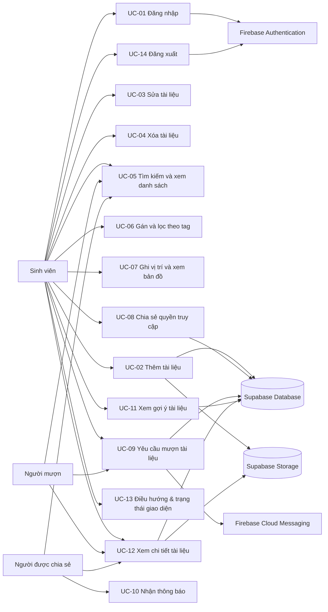

# ĐẶC TẢ USE CASE: Ứng dụng Quản lý Tài liệu Học tập

**Dự án:** Ứng dụng Quản lý Tài liệu Học tập
**Kiến trúc:** Firebase (Authentication / Messaging) + Supabase (Database / Storage), giao diện Flutter đa nền tảng
**Phiên bản tài liệu:** 2.1 — cập nhật 20/10/2026

> Bản 2.1 bổ sung use case cho các màn hình còn thiếu trong checklist giao diện: đăng nhập, xem chi tiết tài liệu, điều hướng responsive và các trạng thái loading / empty / error; đồng thời cập nhật bảng phân công theo kế hoạch mới.
> Bản 2.0 bổ sung các use case cho tính năng mới (tag, vị trí vật lý, chia sẻ, mượn tài liệu, thông báo, gợi ý tài liệu) và chỉnh lại phần mô tả tầng dữ liệu cho khớp với mã nguồn hiện tại.
> Phần mô tả cũ dùng SQLite/Drift cục bộ đã được thay bằng Supabase; `lib/database/` nay chỉ còn là lớp cache cục bộ chưa dùng đến.

---

## 1. Tác nhân (Actor)

| Tác nhân | Mô tả |
|---|---|
| **Khách (người dùng ẩn danh)** | Người mới mở ứng dụng, được Firebase Auth cấp tài khoản ẩn danh để dùng ngay |
| **Sinh viên (chủ tài liệu)** | Người dùng đã đăng nhập, sở hữu tài liệu: thêm, sửa, xóa, gán tag, ghi vị trí, chia sẻ |
| **Người được chia sẻ** | Người dùng khác được cấp quyền `viewer` hoặc `editor` trên tài liệu |
| **Người mượn** | Người dùng gửi yêu cầu mượn tài liệu và nhận kết quả duyệt |
| **Hệ thống phụ trợ** | Firebase Authentication (định danh), Firebase Cloud Messaging (thông báo), Supabase PostgREST/Realtime (dữ liệu), Supabase Storage (tệp) |

Một người dùng có thể đồng thời là chủ tài liệu ở tài liệu này và là người mượn ở tài liệu khác.

---

## 2. Sơ đồ use case tổng quan

---

## 3. Danh sách use case

| Mã | Tên use case | Tác nhân chính | Hạng mục checklist | Người phụ trách |
|---|---|---|---|---|
| UC-01 | Đăng nhập và đồng bộ người dùng | Khách, Sinh viên | #1 | Minh |
| UC-02 | Thêm tài liệu học tập | Sinh viên | #1 | Minh |
| UC-03 | Cập nhật tài liệu | Sinh viên | #1 | Minh |
| UC-04 | Xóa tài liệu và tệp đính kèm | Sinh viên | #1 | Minh |
| UC-05 | Tìm kiếm, lọc và xem danh sách | Sinh viên, Người được chia sẻ | #2 | Minh |
| UC-06 | Gán tag và lọc theo tag | Sinh viên | #3 | Đạt |
| UC-07 | Ghi nhận vị trí vật lý và xem bản đồ | Sinh viên | #3 | Quân |
| UC-08 | Chia sẻ quyền truy cập tài liệu | Sinh viên | #4 | Đăng |
| UC-09 | Yêu cầu mượn tài liệu | Người mượn | #4 | Đăng |
| UC-10 | Nhận thông báo về yêu cầu mượn | Người mượn, Sinh viên | #1, #4 | Đăng |
| UC-11 | Xem gợi ý tài liệu | Sinh viên | #5 | Hạnh |
| UC-12 | Xem chi tiết tài liệu | Sinh viên, Người được chia sẻ, Người mượn | #2 | Minh |
| UC-13 | Điều hướng và trạng thái giao diện | Khách, Sinh viên, Người được chia sẻ, Người mượn | #2 | Minh |
| UC-14 | Đăng xuất | Sinh viên | #1, #2 | Minh |

> Phân công cập nhật theo bảng phân chia công việc ngày 20/10/2026: Minh phụ trách #1 và #2, Đạt #3 (tag), Quân #3 (bản đồ), Đăng #4 (mượn và chia sẻ), Hạnh #5 (recommendation). Hạng mục #6 (kiểm thử toàn diện và đóng gói) do cả nhóm thực hiện.

---

## 4. Đặc tả chi tiết

### UC-01. Đăng nhập và đồng bộ người dùng

**Mô tả:** Người dùng đăng nhập bằng Email/Mật khẩu hoặc Google trên màn hình đăng nhập; Firebase Authentication định danh, sau đó bản ghi tương ứng được đồng bộ sang bảng `users` của Supabase để phục vụ phân quyền và chia sẻ.
**Tác nhân:** Khách, Sinh viên.
**Tiền điều kiện:** Ứng dụng khởi động, Firebase và Supabase đã khởi tạo thành công.
**Hậu điều kiện:** Người dùng có UID hợp lệ; tồn tại bản ghi trong `users` khớp UID; ứng dụng chuyển vào trang chủ.

**Chuỗi sự kiện chính:**
1. Khi khởi động, ứng dụng kiểm tra phiên đăng nhập hiện có của Firebase Auth.
2. Nếu chưa có phiên, ứng dụng hiển thị màn hình đăng nhập (`login_page.dart`) gồm: ô Email, ô Mật khẩu, nút `Đăng nhập`, nút `Đăng nhập bằng Google` và liên kết `Dùng thử không cần tài khoản`.
3. Người dùng nhập Email/Mật khẩu hoặc chọn đăng nhập Google.
4. Giao diện kiểm tra dữ liệu (email đúng định dạng, mật khẩu tối thiểu 6 ký tự), hiển thị trạng thái loading và khóa nút gửi.
5. Firebase xác thực thông tin đăng nhập và trả về UID.
6. Lớp logic (`functions.dart`) lấy ID token, gọi Edge Function để đổi sang Supabase JWT và thiết lập phiên Supabase.
7. Lớp logic chèn hoặc cập nhật bản ghi trong bảng `users`; tải danh mục mặc định nếu chưa có.
8. Giao diện đóng màn hình đăng nhập và mở trang chủ.

**Luồng thay thế:**
- *1a. Đăng nhập Google:* Người dùng chọn "Đăng nhập bằng Google"; hệ thống lấy thông tin từ Google Sign-In, tạo credential Firebase rồi tiếp tục bước 5.
- *1b. Đã có phiên:* Bỏ qua màn hình đăng nhập, vào thẳng trang chủ sau khi đồng bộ người dùng.
- *1c. Dùng thử ẩn danh:* Hệ thống đăng nhập ẩn danh, đồng bộ Supabase và giới hạn một số tính năng chia sẻ cho đến khi liên kết tài khoản.
- *1d. Lỗi đồng bộ Supabase:* Ứng dụng vẫn cho phép dùng ở chế độ hạn chế, hiển thị banner cảnh báo và ghi log để xử lý sau.

**Ngoại lệ:**
- *1e. Sai email hoặc mật khẩu:* Hiển thị lỗi ngay dưới ô nhập, không chuyển màn hình.
- *1f. Mất mạng:* Hiển thị thông báo không có kết nối kèm nút `Thử lại`.
- *1g. Người dùng hủy đăng nhập Google:* Ứng dụng giữ nguyên màn hình đăng nhập, không báo lỗi.

**Dữ liệu liên quan:** Firebase Authentication, bảng `users`.
**Tiêu chí chấp nhận:** Đăng nhập xong, tab Users của Firebase và bảng `users` trên Supabase có cùng UID; màn hình đăng nhập hiển thị đúng trên Mobile và Web; có trạng thái loading và thông báo lỗi rõ ràng.

---

### UC-02. Thêm tài liệu học tập

**Mô tả:** Cho phép người dùng thêm tài liệu mới kèm phân loại, mô tả và tệp đính kèm.
**Tác nhân:** Sinh viên.
**Tiền điều kiện:** Người dùng đã đăng nhập và đang ở màn hình danh sách.
**Hậu điều kiện:** Bản ghi được lưu trong bảng `documents`; tệp (nếu có) nằm trong bucket `documents`; danh sách hiển thị tài liệu mới.

**Chuỗi sự kiện chính:**
1. Người dùng nhấn nút `[+]` trên giao diện.
2. Hệ thống mở màn hình thêm tài liệu (`document_form_page.dart`).
3. Người dùng nhập `Tiêu đề` (bắt buộc), `Mô tả`, chọn `Danh mục`, chọn tệp hoặc nhập đường dẫn, gán tag và vị trí lưu trữ.
4. Người dùng nhấn `[Lưu]`.
5. Giao diện kiểm tra dữ liệu hợp lệ rồi chuyển xuống lớp logic (`functions.dart`), không truy vấn cơ sở dữ liệu trực tiếp.
6. Lớp logic tải tệp lên Supabase Storage với đường dẫn `users/{uid}/documents/{docId}/{ten-tệp}`, nhận URL công khai.
7. Lớp logic gọi service chèn bản ghi vào bảng `documents` kèm `user_id`, `category_id`, `file_url`, `storage_path`.
8. Hệ thống thông báo "Đã thêm tài liệu", quay lại danh sách và làm mới giao diện.

**Luồng thay thế:**
- *2a. Không đính kèm tệp:* Bỏ qua bước 6, bản ghi vẫn được tạo với `file_url` rỗng.

**Ngoại lệ:**
- *2b. Thiếu tiêu đề:* Hiển thị lỗi ngay tại ô nhập liệu, không gọi xuống lớp logic.
- *2c. Tải tệp thất bại:* Hiển thị thông báo lỗi, không tạo bản ghi để tránh dữ liệu trỏ tới tệp không tồn tại.

**Dữ liệu liên quan:** `documents`, `categories`, `document_tags`, `document_locations`, Supabase Storage.
**Tiêu chí chấp nhận:** Tài liệu xuất hiện trong danh sách; tệp mở được từ URL; gán được nhiều tag cho một tài liệu; form hiển thị 1 cột trên mobile và 2 cột trên Web; nút `Lưu` có trạng thái loading và báo lỗi rõ ràng khi lưu thất bại.

---

### UC-03. Cập nhật tài liệu

**Mô tả:** Người dùng chỉnh sửa thông tin tài liệu đã lưu, kể cả thay tệp đính kèm.
**Tác nhân:** Sinh viên (chủ sở hữu) hoặc người có quyền `editor`.
**Tiền điều kiện:** Tài liệu tồn tại và người dùng có quyền sửa.
**Hậu điều kiện:** Bản ghi được cập nhật; `updated_at` thay đổi; tệp cũ được thay thế nếu có tệp mới.

**Chuỗi sự kiện chính:**
1. Người dùng chọn `[Chỉnh sửa]` trên thẻ tài liệu.
2. Hệ thống mở form và nạp sẵn dữ liệu cũ (tiêu đề, mô tả, danh mục, tag, vị trí).
3. Người dùng thay đổi thông tin cần thiết.
4. Người dùng nhấn `[Lưu]`.
5. Lớp logic cập nhật bản ghi trong `documents`; nếu có tệp mới thì tải tệp mới lên và xóa tệp cũ trong Storage.
6. Hệ thống thông báo thành công và làm mới danh sách.

**Luồng thay thế:**
- *3a. Hủy:* Người dùng nhấn `[Hủy]` hoặc Back; form đóng, không ghi dữ liệu.

**Ngoại lệ:**
- *3b. Không có quyền:* Người dùng chỉ có quyền `viewer` sẽ không thấy nút sửa; nếu cố gửi yêu cầu, chính sách RLS trên Supabase từ chối.

**Tiêu chí chấp nhận:** `updated_at` đổi; tệp cũ không còn trong Storage sau khi thay tệp.

---

### UC-04. Xóa tài liệu và tệp đính kèm

**Mô tả:** Người dùng xóa tài liệu không còn dùng, hệ thống xóa cả bản ghi và tệp.
**Tác nhân:** Sinh viên (chủ sở hữu).
**Tiền điều kiện:** Tài liệu tồn tại và thuộc sở hữu của người dùng.
**Hậu điều kiện:** Bản ghi và tệp bị xóa khỏi hệ thống.

**Chuỗi sự kiện chính:**
1. Người dùng nhấn biểu tượng `[Xóa]` trên thẻ tài liệu.
2. Hệ thống hiển thị hộp thoại xác nhận (`confirm_dialog.dart`).
3. Người dùng chọn `[Đồng ý]`.
4. Lớp logic xóa tệp trong Storage theo `storage_path`.
5. Lớp logic xóa bản ghi trong `documents`.
6. Hệ thống thông báo "Đã xóa tài liệu" và loại thẻ tài liệu khỏi danh sách.

**Luồng thay thế:**
- *4a. Từ chối xóa:* Người dùng chọn `[Hủy]`; giữ nguyên hiện trạng.

**Ngoại lệ:**
- *4b. Không phải chủ sở hữu:* Nút xóa không hiển thị; RLS từ chối lệnh xóa nếu có yêu cầu trực tiếp.

**Tiêu chí chấp nhận:** Sau khi xóa, bản ghi không còn trong bảng và tệp không còn trong bucket.

---

### UC-05. Tìm kiếm, lọc và xem danh sách

**Mô tả:** Người dùng xem trang chủ tổng quan và màn hình danh sách tài liệu của mình cùng tài liệu được chia sẻ; tìm theo từ khóa, lọc theo danh mục/tag và mở chi tiết tài liệu.
**Tác nhân:** Sinh viên, Người được chia sẻ, Người mượn.
**Tiền điều kiện:** Ứng dụng mở thành công, người dùng đã đăng nhập.
**Hậu điều kiện:** Danh sách hiển thị đúng tập tài liệu thỏa điều kiện; người dùng mở được chi tiết tài liệu.

**Chuỗi sự kiện chính:**
1. Sau khi đăng nhập, người dùng được đưa tới trang chủ (`home_page.dart`) hiển thị tổng quan: số tài liệu, danh mục, tài liệu gần đây và lối tắt thêm tài liệu.
2. Người dùng chọn mục `Tài liệu` trên thanh điều hướng để mở danh sách (`document_list_page.dart`).
3. Hệ thống hiển thị trạng thái loading trong khi tải song song danh mục, tag và danh sách tài liệu.
4. Giao diện hiển thị dạng lưới thẻ tài liệu, số cột thay đổi theo kích thước màn hình (mobile 1–2 cột, tablet 2–3 cột, web 3–4 cột).
5. Người dùng nhập từ khóa vào thanh tìm kiếm; giao diện chờ người dùng ngừng gõ rồi mới gửi yêu cầu xuống lớp logic.
6. Lớp logic truy vấn `documents` theo tiêu đề/mô tả và điều kiện lọc, trả về danh sách model.
7. Người dùng chạm vào thẻ tài liệu để mở màn hình chi tiết (UC-12).
8. Kênh realtime tiếp tục lắng nghe thay đổi để tự làm mới danh sách.

**Luồng thay thế:**
- *5a. Lọc theo danh mục hoặc tag:* Người dùng chọn chip lọc; danh sách chỉ hiển thị tài liệu khớp.
- *5b. Xem tài liệu được chia sẻ:* Người dùng mở mục "Được chia sẻ", hệ thống truy vấn bảng `permissions` để lấy danh sách tương ứng.
- *5c. Xóa nhanh:* Người dùng nhấn biểu tượng xóa trên thẻ, hệ thống xác nhận rồi xóa mà không tải lại toàn trang (UC-04).

**Ngoại lệ:**
- *5d. Không có kết quả:* Hiển thị trạng thái trống "Không tìm thấy tài liệu phù hợp".
- *5e. Chưa có tài liệu:* Hiển thị hướng dẫn "Bạn chưa có tài liệu nào, hãy nhấn (+) để thêm mới".
- *5f. Tải dữ liệu thất bại:* Hiển thị màn hình lỗi kèm nút `Thử lại`.

**Tiêu chí chấp nhận:** Không tràn layout ở 360px, 768px và 1440px; có đủ trạng thái loading/empty/error; tìm kiếm và lọc cập nhật danh sách; chạm thẻ mở đúng chi tiết; realtime cập nhật khi mở hai phiên làm việc.

---

### UC-06. Gán tag và lọc theo tag

**Mô tả:** Người dùng phân loại tài liệu theo nhiều tag (ngoài danh mục) và lọc danh sách theo tag.
**Tác nhân:** Sinh viên.
**Tiền điều kiện:** Tồn tại ít nhất một tag hoặc người dùng tạo tag mới.
**Hậu điều kiện:** Quan hệ tài liệu – tag được lưu; bộ lọc theo tag hoạt động.

**Chuỗi sự kiện chính:**
1. Trong form tài liệu, người dùng nhấn vào khu vực `Tag`.
2. Hệ thống hiển thị danh sách tag hiện có và ô nhập tag mới.
3. Người dùng chọn một hoặc nhiều tag, có thể tạo tag mới kèm màu.
4. Người dùng lưu tài liệu.
5. Lớp logic ghi quan hệ vào bảng `document_tags`.
6. Ở trang chủ, người dùng chọn một hoặc nhiều chip tag để lọc danh sách.

**Luồng thay thế:**
- *6a. Gỡ tag:* Người dùng bỏ chọn tag; lớp logic xóa bản ghi tương ứng trong `document_tags`.

**Ngoại lệ:**
- *6b. Tag trùng tên:* Hệ thống dùng lại tag đã có thay vì tạo mới.

**Tiêu chí chấp nhận:** Một tài liệu gán được nhiều tag; lọc theo 2 tag trở lên trả về đúng kết quả; tài liệu chưa có tag vẫn hiển thị bình thường.

---

### UC-07. Ghi nhận vị trí vật lý và xem bản đồ

**Mô tả:** Người dùng ghi lại vị trí thực tế của tài liệu (kệ, phòng, toạ độ) để tìm lại nhanh.
**Tác nhân:** Sinh viên.
**Tiền điều kiện:** Người dùng đang ở form tài liệu; thiết bị có dịch vụ vị trí hoặc người dùng nhập địa chỉ thủ công.
**Hậu điều kiện:** Vị trí được lưu trong `document_locations`; bản đồ hiển thị đúng điểm đã lưu.

**Chuỗi sự kiện chính:**
1. Người dùng chọn `Chọn vị trí` trong form tài liệu.
2. Hệ thống xin quyền truy cập vị trí.
3. Người dùng chọn vị trí trên bản đồ hoặc dùng vị trí hiện tại.
4. Người dùng nhập thêm mô tả: tên địa điểm, kệ, ghi chú.
5. Người dùng lưu; lớp logic ghi vào bảng `document_locations`.
6. Ở trang chi tiết tài liệu, người dùng nhấn `Chỉ đường` để mở ứng dụng bản đồ.

**Luồng thay thế:**
- *7a. Từ chối quyền vị trí:* Hệ thống cho phép nhập địa chỉ hoặc mô tả vị trí bằng tay, vẫn lưu được.

**Ngoại lệ:**
- *7b. Không có mạng khi tải bản đồ:* Hiển thị toạ độ và mô tả văn bản thay cho bản đồ.

**Tiêu chí chấp nhận:** Vị trí lưu và mở lại đúng; bản đồ render trên cả Android và Web; có phương án dự phòng khi mất quyền vị trí.

---

### UC-08. Chia sẻ quyền truy cập tài liệu

**Mô tả:** Chủ tài liệu cấp quyền xem hoặc chỉnh sửa cho người dùng khác, và có thể thu hồi.
**Tác nhân:** Sinh viên (chủ sở hữu).
**Tiền điều kiện:** Tài liệu thuộc sở hữu của người dùng.
**Hậu điều kiện:** Bản ghi quyền được tạo trong `permissions`; người được chia sẻ thấy tài liệu trong mục "Được chia sẻ".

**Chuỗi sự kiện chính:**
1. Trên thẻ tài liệu, người dùng chọn `[Chia sẻ]` để mở `share_dialog.dart`.
2. Hệ thống hiển thị danh sách người đang có quyền và ô tìm kiếm người dùng.
3. Người dùng tìm theo tên hoặc email, chọn người nhận.
4. Người dùng chọn vai trò `Người xem` hoặc `Người chỉnh sửa` rồi xác nhận.
5. Lớp logic ghi bản ghi vào `permissions` với `granted_by` là người thực hiện.
6. Người được chia sẻ nhận tài liệu khi mở lại ứng dụng.

**Luồng thay thế:**
- *8a. Thu hồi quyền:* Người dùng chọn người trong danh sách và nhấn `[Thu hồi]`; bản ghi quyền bị xóa.
- *8b. Đổi vai trò:* Người dùng cập nhật từ `viewer` sang `editor` hoặc ngược lại.

**Ngoại lệ:**
- *8c. Không tìm thấy người dùng:* Hiển thị "Không tìm thấy người dùng" và giữ nguyên danh sách quyền.
- *8d. Chia sẻ cho chính mình:* Hệ thống chặn và thông báo không hợp lệ.

**Tiêu chí chấp nhận:** Người có quyền `viewer` chỉ xem được; `editor` sửa được nhưng không xóa được; chủ sở hữu luôn giữ toàn quyền.

---

### UC-09. Yêu cầu mượn tài liệu

**Mô tả:** Người dùng gửi yêu cầu mượn tài liệu của người khác; chủ tài liệu duyệt hoặc từ chối; hai bên theo dõi trạng thái.
**Tác nhân:** Người mượn, Sinh viên (chủ tài liệu).
**Tiền điều kiện:** Tài liệu tồn tại và người dùng không phải chủ sở hữu, không có yêu cầu đang chờ cho cùng tài liệu.
**Hậu điều kiện:** Yêu cầu được lưu với trạng thái `pending`; sau khi duyệt, người mượn có quyền truy cập trong thời hạn mượn.

**Chuỗi sự kiện chính:**
1. Người dùng mở tài liệu trong danh sách công khai hoặc được chia sẻ.
2. Người dùng nhấn `[Yêu cầu mượn]`, nhập lời nhắn và thời hạn mong muốn.
3. Lớp logic tạo bản ghi trong `borrow_requests` với trạng thái `pending`.
4. Hệ thống gửi thông báo cho chủ tài liệu (UC-10).
5. Chủ tài liệu mở tab `Yêu cầu`, xem chi tiết và chọn `[Duyệt]` hoặc `[Từ chối]`.
6. Nếu duyệt, hệ thống cấp quyền truy cập có thời hạn và thông báo cho người mượn.
7. Người mượn sử dụng tài liệu; khi xong, nhấn `[Đã trả]`.
8. Hệ thống chuyển trạng thái sang `returned` và thu hồi quyền tạm thời.

**Luồng thay thế:**
- *9a. Người mượn tự hủy:* Khi yêu cầu còn `pending`, người mượn nhấn `[Hủy yêu cầu]`, trạng thái chuyển thành `cancelled`.
- *9b. Chủ tài liệu từ chối:* Trạng thái chuyển thành `rejected`, người mượn nhận thông báo kèm lý do nếu có.

**Ngoại lệ:**
- *9c. Đã có yêu cầu đang chờ:* Hệ thống chặn tạo trùng và thông báo đang chờ duyệt.
- *9d. Quá hạn mượn:* Hệ thống đánh dấu quá hạn, gửi nhắc nhở và có thể thu hồi quyền.

**Tiêu chí chấp nhận:** Không thể chuyển sang trạng thái không hợp lệ (ví dụ `returned` khi chưa `approved`); người ngoài không đọc được yêu cầu của người khác.

---

### UC-10. Nhận thông báo về yêu cầu mượn

**Mô tả:** Người dùng nhận thông báo khi có yêu cầu mượn mới hoặc khi yêu cầu của mình được xử lý.
**Tác nhân:** Người mượn, Sinh viên.
**Tiền điều kiện:** Người dùng đã cho phép thông báo; token thiết bị đã lưu trong `device_tokens`.
**Hậu điều kiện:** Thông báo được hiển thị và lưu vào bảng `notifications`.

**Chuỗi sự kiện chính:**
1. Khi có sự kiện (yêu cầu mới, duyệt, từ chối), hệ thống ghi bản ghi vào `notifications`.
2. Hàm Edge Function lấy token của người nhận từ `device_tokens`.
3. Firebase Cloud Messaging gửi thông báo tới thiết bị/trình duyệt.
4. Người dùng nhấn thông báo, ứng dụng mở tab `Yêu cầu`.
5. Thông báo được đánh dấu đã đọc.

**Luồng thay thế:**
- *10a. Người dùng từ chối quyền thông báo:* Thông báo vẫn được lưu và hiển thị dưới dạng badge trong ứng dụng.

**Ngoại lệ:**
- *10b. Token hết hạn:* Hệ thống xóa token khỏi `device_tokens` khi FCM trả lỗi không hợp lệ.

**Tiêu chí chấp nhận:** Thông báo đến trong vòng 10 giây kể từ khi sự kiện phát sinh; badge số lượng chờ duyệt hiển thị đúng.

---

### UC-11. Xem gợi ý tài liệu

**Mô tả:** Hệ thống gợi ý tài liệu dựa trên tag và hành vi của người dùng, kèm lý do gợi ý.
**Tác nhân:** Sinh viên.
**Tiền điều kiện:** Người dùng đã đăng nhập; có dữ liệu tài liệu trong hệ thống.
**Hậu điều kiện:** Khối "Gợi ý cho bạn" hiển thị danh sách tài liệu kèm lý do.

**Chuỗi sự kiện chính:**
1. Người dùng mở trang chủ.
2. Lớp logic đọc sở thích từ `user_interests` và lịch sử xem từ `document_views`.
3. Hệ thống tính điểm cho từng tài liệu ứng viên:
   `score = 0.5 × tỉ lệ tag trùng + 0.3 × độ mới + 0.2 × lượt xem` (chuẩn hoá 0–1).
4. Hệ thống loại tài liệu của chính người dùng và tài liệu vừa xem gần đây.
5. Giao diện hiển thị tối đa 5 tài liệu điểm cao nhất kèm lý do (ví dụ "Vì bạn quan tâm #Giải tích").
6. Khi người dùng mở hoặc gán tag cho tài liệu, trọng số sở thích tương ứng được cập nhật.

**Luồng thay thế:**
- *11a. Người dùng mới (cold start):* Chưa có `user_interests`, hệ thống gợi ý theo tag phổ biến và tài liệu mới nhất.

**Ngoại lệ:**
- *11b. Không đủ dữ liệu:* Nếu không có tài liệu ứng viên, khối gợi ý được ẩn thay vì hiển thị trống.

**Tiêu chí chấp nhận:** Kết quả trả về dưới 300ms với 200 tài liệu; mỗi gợi ý có lý do hiển thị được; gợi ý thay đổi khi sở thích thay đổi.

---

### UC-12. Xem chi tiết tài liệu

**Mô tả:** Người dùng mở một tài liệu để xem đầy đủ thông tin (tiêu đề, mô tả, danh mục, tag, vị trí, tệp đính kèm) và thực hiện các hành động phù hợp với quyền của mình.
**Tác nhân:** Sinh viên (chủ sở hữu), Người được chia sẻ, Người mượn.
**Tiền điều kiện:** Tài liệu tồn tại và người dùng có quyền đọc tài liệu đó.
**Hậu điều kiện:** Thông tin chi tiết được hiển thị; dữ liệu không thay đổi trừ khi người dùng thực hiện hành động sửa, chia sẻ hoặc xóa.

**Chuỗi sự kiện chính:**
1. Người dùng chạm vào thẻ tài liệu ở trang chủ hoặc màn hình danh sách.
2. Hệ thống mở màn hình chi tiết (`document_detail_page.dart`) và hiển thị trạng thái loading trong khi tải.
3. Lớp logic lấy dữ liệu tài liệu kèm tag, vị trí và quyền của người dùng hiện tại.
4. Giao diện hiển thị tiêu đề, mô tả, danh mục, tag, vị trí, ngày tạo/cập nhật và tệp đính kèm.
5. Nếu có tệp, người dùng nhấn `Mở tệp` để mở bằng trình duyệt hoặc ứng dụng phù hợp.
6. Giao diện chỉ hiển thị các nút `Sửa`, `Chia sẻ`, `Xóa` khi người dùng có quyền tương ứng; hiển thị `Yêu cầu mượn` với người không phải chủ sở hữu.
7. Người dùng quay lại danh sách; danh sách giữ nguyên từ khóa và bộ lọc trước đó.

**Luồng thay thế:**
- *12a. Tài liệu không có tệp:* Ẩn nút `Mở tệp` và hiển thị "Chưa có tệp đính kèm".
- *12b. Mở chi tiết từ thông báo:* Hệ thống điều hướng thẳng tới chi tiết tài liệu tương ứng.
- *12c. Chỉ có quyền xem:* Ẩn nút `Sửa` và `Xóa`; nút `Chia sẻ` chỉ hiển thị với chủ sở hữu.

**Ngoại lệ:**
- *12d. Tải chi tiết thất bại:* Hiển thị trạng thái lỗi kèm nút `Thử lại`.
- *12e. Tệp không mở được:* Hiển thị thông báo lỗi và giữ nguyên màn hình chi tiết.
- *12f. Không có quyền truy cập:* Hiển thị thông báo "Bạn không có quyền xem tài liệu này" và quay lại danh sách.

**Dữ liệu liên quan:** `documents`, `categories`, `document_tags`, `document_locations`, `permissions`, Supabase Storage.
**Tiêu chí chấp nhận:** Mở chi tiết đúng tài liệu trên cả Mobile và Web; thông tin khớp bản ghi; nút hành động đúng quyền; quay lại không mất bộ lọc.

---

### UC-13. Điều hướng và trạng thái giao diện đa nền tảng

**Mô tả:** Người dùng di chuyển giữa các màn hình trên Mobile và Web, và luôn nhận phản hồi rõ ràng khi hệ thống đang tải, không có dữ liệu hoặc gặp lỗi.
**Tác nhân:** Khách, Sinh viên, Người được chia sẻ, Người mượn.
**Tiền điều kiện:** Ứng dụng đã khởi tạo và đang chạy trên Android hoặc trình duyệt Web.
**Hậu điều kiện:** Màn hình đích hiển thị đúng; trạng thái hiện tại của hệ thống được thông báo cho người dùng.

**Chuỗi sự kiện chính:**
1. Người dùng mở ứng dụng trên điện thoại hoặc trình duyệt.
2. Hệ thống xác định breakpoint: `compact` (< 600px), `medium` (600–1024px), `expanded` (≥ 1024px).
3. Giao diện dựng khung điều hướng tương ứng: bottom navigation trên mobile, navigation rail trên tablet, rail kèm vùng nội dung rộng trên Web.
4. Người dùng chọn mục điều hướng (Trang chủ, Tài liệu) hoặc mở chi tiết tài liệu từ danh sách; menu tài khoản ở góc phải cho phép đăng xuất.
5. Trong khi tải dữ liệu, giao diện hiển thị loading indicator hoặc skeleton.
6. Khi không có dữ liệu, giao diện hiển thị Empty Component kèm hướng dẫn; khi lỗi, hiển thị thông báo và nút `Thử lại`.
7. Trên Web, nút quay lại của ứng dụng đưa người dùng về màn hình trước đó và giữ nguyên bộ lọc đang áp dụng.

**Luồng thay thế:**
- *13a. Màn hình hẹp:* Nội dung một cột, form và danh sách cuộn dọc.
- *13b. Màn hình rộng:* Nội dung giới hạn chiều rộng tối đa, lưới nhiều cột, dialog thay cho bottom sheet.
- *13c. Xoay thiết bị hoặc đổi kích thước cửa sổ:* Bố cục cập nhật ngay, không mất dữ liệu đang nhập.

**Ngoại lệ:**
- *13d. Mất mạng:* Hiển thị trạng thái lỗi có thể thử lại, không hiển thị màn hình trắng.
- *13e. Điều hướng tới tài liệu không tồn tại:* Hiển thị trạng thái "Tài liệu không tồn tại" kèm nút quay lại danh sách.

**Tiêu chí chấp nhận:** Không tràn layout tại 360px, 768px và 1440px; loading/empty/error xuất hiện đúng thời điểm; điều hướng không làm mất ngữ cảnh tìm kiếm; nút Back hoạt động đúng trên cả Mobile và Web.

---

### UC-14. Đăng xuất

**Mô tả:** Người dùng kết thúc phiên làm việc và quay về màn hình đăng nhập.
**Tác nhân:** Sinh viên.
**Tiền điều kiện:** Người dùng đang đăng nhập.
**Hậu điều kiện:** Phiên Firebase và Supabase bị hủy; dữ liệu người dùng được xóa khỏi bộ nhớ ứng dụng; màn hình đăng nhập hiển thị.

**Chuỗi sự kiện chính:**
1. Người dùng mở menu tài khoản ở góc phải thanh ứng dụng.
2. Người dùng chọn `Đăng xuất`.
3. Hệ thống hiển thị hộp thoại xác nhận.
4. Người dùng chọn `Đồng ý`.
5. Lớp logic gọi `signOut()` để đăng xuất Google, Firebase và Supabase.
6. Ứng dụng xóa trạng thái người dùng và chuyển về màn hình đăng nhập (UC-01).

**Luồng thay thế:**
- *14a. Hủy đăng xuất:* Người dùng chọn `Hủy`; giữ nguyên phiên và màn hình hiện tại.

**Ngoại lệ:**
- *14b. Lỗi mạng khi đăng xuất:* Ứng dụng vẫn xóa phiên cục bộ, hiển thị cảnh báo và chuyển về màn hình đăng nhập.

**Tiêu chí chấp nhận:** Sau khi đăng xuất, không thể quay lại màn hình cũ bằng nút Back; mở lại ứng dụng hiển thị màn hình đăng nhập.

---

## 5. Ma trận truy vết use case ↔ checklist dự án

| Hạng mục checklist | Use case liên quan | Người phụ trách | Minh chứng cần nộp |
|---|---|---|---|
| #1 Thiết kế kiến trúc và mô hình dữ liệu Firebase + Supabase | UC-01, UC-02, UC-03, UC-04, UC-14 | Minh | Sơ đồ kiến trúc, schema và RLS, Edge Function |
| #2 Giao diện Flutter đa nền tảng, responsive | UC-05, UC-12, UC-13 và toàn bộ giao diện của các UC khác | Minh | Ảnh chụp 3 breakpoint, không lỗi overflow, đủ trạng thái loading/empty/error |
| #3 Phân loại bằng Tag và quản lý vị trí vật lý | UC-06 (Đạt), UC-07 (Quân) | Đạt, Quân | Màn hình tag, lọc tag, bản đồ và vị trí đã lưu |
| #4 Luồng yêu cầu mượn và chia sẻ quyền | UC-08, UC-09, UC-10 | Đăng | Bản ghi `permissions`, `borrow_requests`, thông báo |
| #5 Thuật toán Recommendation | UC-11 | Hạnh | Hàm chấm điểm, khối gợi ý kèm lý do, unit test |
| #6 Kiểm thử toàn diện và đóng gói | Kiểm thử cho UC-01 → UC-14 | Cả nhóm | Test plan, kết quả test, APK + bản Web |

---

## 6. Ràng buộc kiến trúc và phi chức năng

**Ràng buộc kiến trúc:**
1. Widget trong `lib/pages/` và `lib/widgets/` không truy vấn cơ sở dữ liệu trực tiếp; mọi thao tác đi qua `lib/functions.dart` và lớp service.
2. Model trung gian trong `lib/struct/` là đối tượng duy nhất mà giao diện tương tác.
3. `architecture_test.dart` phải pass sau mọi thay đổi.

**Phi chức năng:**
| Tiêu chí | Yêu cầu |
|---|---|
| Đa nền tảng | Chạy được trên Android và Web từ cùng một mã nguồn |
| Responsive | Không tràn layout ở 360px, 768px, 1440px |
| Hiệu năng | Tải danh sách dưới 2 giây với 200 tài liệu; gợi ý dưới 300ms; thông báo tới trong 10 giây |
| Bảo mật | RLS bật cho mọi bảng dữ liệu người dùng; người ngoài không đọc được tài liệu riêng |
| Khả dụng | Có trạng thái trống, trạng thái lỗi và thông báo rõ ràng cho người dùng |
| Kiểm thử | Unit test cho service và thuật toán; widget test cho màn hình chính; test RLS với hai tài khoản |

---

## 7. Thay đổi so với các bản trước

| Nội dung | Bản 1.0 | Bản 2.0 | Bản 2.1 |
|---|---|---|---|
| Tầng dữ liệu | SQLite/Drift cục bộ | Supabase PostgREST + Storage, Firebase Auth | Giữ nguyên |
| Tác nhân | Một tác nhân duy nhất | 6 tác nhân | Giữ nguyên, bổ sung quyền cho UC-12 |
| Số use case | 4 | 11 | 14 |
| Bổ sung | — | UC-01 đăng nhập, UC-06 tag, UC-07 vị trí, UC-08 chia sẻ, UC-09 mượn, UC-10 thông báo, UC-11 gợi ý | UC-12 xem chi tiết tài liệu, UC-13 điều hướng và trạng thái giao diện, UC-14 đăng xuất |
| Chỉnh sửa | UC-02 → UC-04 mô tả theo Drift | Mô tả lại theo Supabase, bổ sung upload/xóa tệp, quyền hạn | UC-01 thêm đăng nhập Email/Mật khẩu và màn hình đăng nhập; UC-05 thêm trang chủ, lưới responsive, loading/empty/error |
| Phân công | — | Minh, Quân, Đạt, Hạnh, Đăng | Cập nhật theo bảng phân chia ngày 20/10/2026: Minh #1–#2, Đạt #3 (tag), Quân #3 (bản đồ), Đăng #4, Hạnh #5 |
